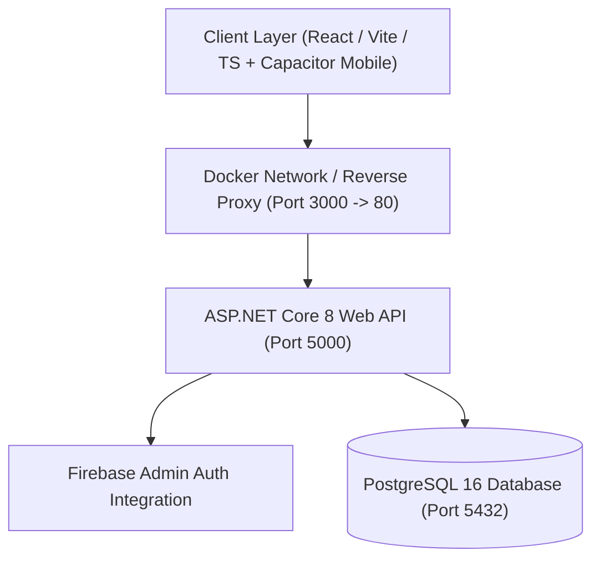

# Darya App 🌊

[](https://dotnet.microsoft.com/)
[](https://react.dev/)
[](https://www.typescriptlang.org/)
[](https://www.postgresql.org/)
[](https://www.docker.com/)
[](https://capacitorjs.com/)
[](LICENSE)

A cross-platform enterprise web and mobile application powered by an **ASP.NET Core Web API**, **Entity Framework Core (PostgreSQL)**, and a **React + TypeScript SPA (Vite)** bundled with **Capacitor** for Android deployment. Fully containerized with **Docker Compose**.

---

## 🏗️ Architecture Overview



### 🧩 Key Components
- **Backend (`/server`):**
  - Built with **.NET 8 / ASP.NET Core** featuring Feature-based Clean Architecture.
  - **Entity Framework Core** with relational schema migrations against PostgreSQL.
  - Firebase Authentication integration (`FirebaseAdmin`) for secure JWT token verification.
- **Frontend & Mobile (`/client`):**
  - **React 18** Single Page Application bundled with **Vite**.
  - Strongly typed state management with **TypeScript**.
  - **Capacitor Android** bridge (`@capacitor/core`, `@capacitor/android`) for native mobile builds.
- **Infrastructure & Deployment:**
  - Multi-stage Docker builds for client and server.
  - Automated service orchestration with **Docker Compose** (`docker-compose.yml` for local dev and `docker-compose.prod.yml` for production).
  - Health check probes on PostgreSQL ensuring deterministic initialization order.

---

## 🚀 Quickstart & Running Locally

### Option 1: One-Command Docker Setup (Recommended)

Make sure [Docker](https://www.docker.com/) is installed and running, then:

```bash
# Clone the repository
git clone https://github.com/Nimasoy/darya_app.git
cd darya_app

# Start the complete stack (Postgres + Backend + Frontend)
docker compose up --build
```

- **Frontend:** Visit [http://localhost:3000](http://localhost:3000)
- **Backend API:** Accessible at [http://localhost:5000](http://localhost:5000)
- **Postgres:** Exposed on port `5432`

---

### Option 2: Running Manually (Local Development)

#### 1. Start PostgreSQL
```bash
docker run -d --name darya-postgres -p 5432:5432 -e POSTGRES_DB=darya -e POSTGRES_USER=darya_user -e POSTGRES_PASSWORD=darya_password postgres:16-alpine
```

#### 2. Run Backend
```bash
cd server
dotnet restore
dotnet run
```

#### 3. Run Frontend
```bash
cd client
npm install
npm run dev
```

---

## 📱 Mobile Build (Android via Capacitor)

```bash
cd client
npm run build
npx cap sync
npx cap open android
```

---

## 📄 License
This project is open-source under the [MIT License](LICENSE).
